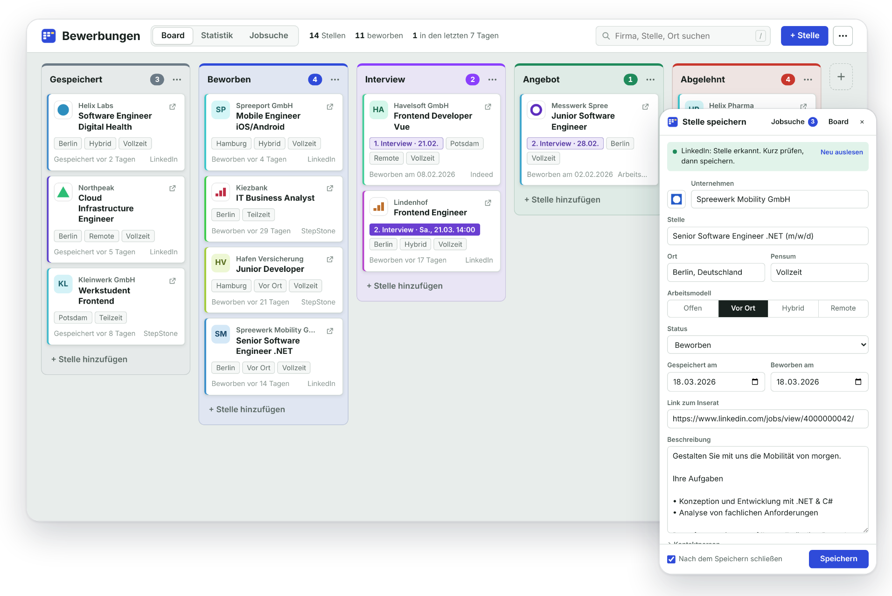
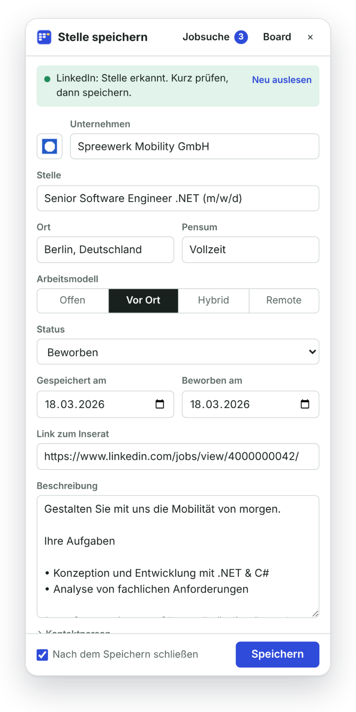
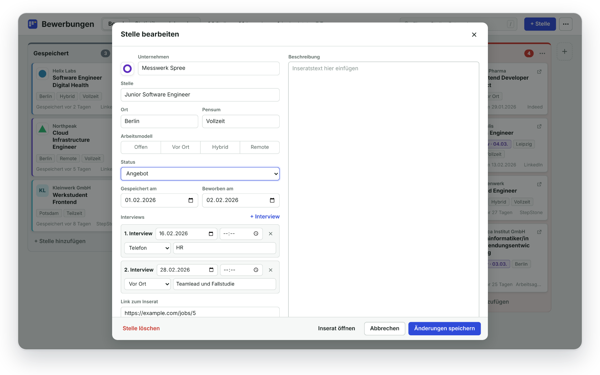
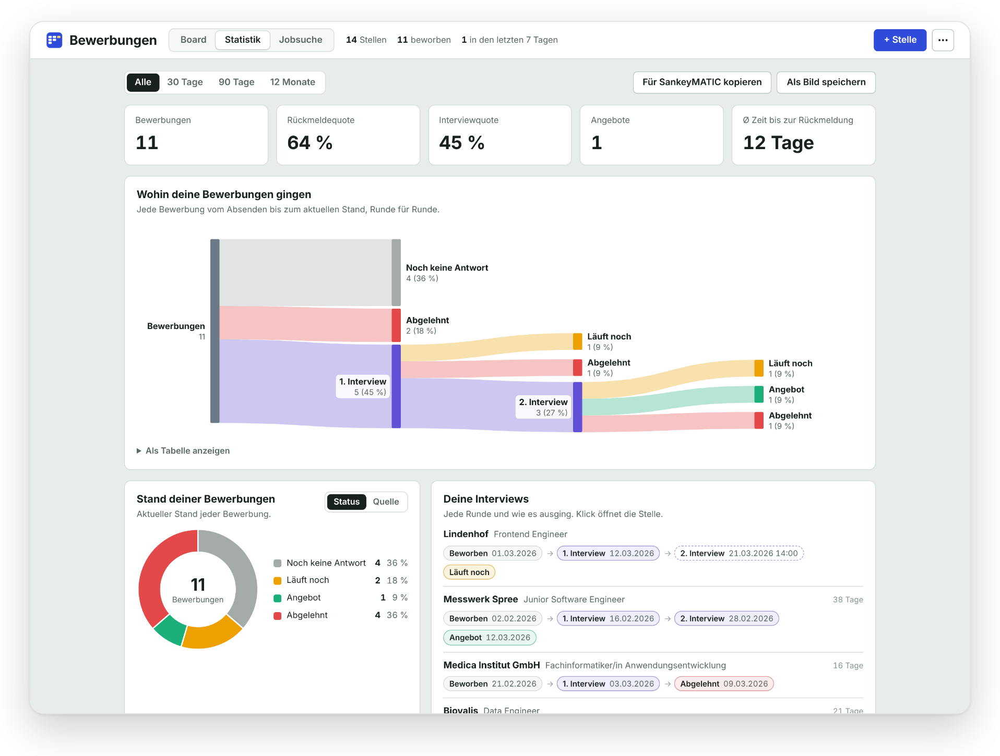
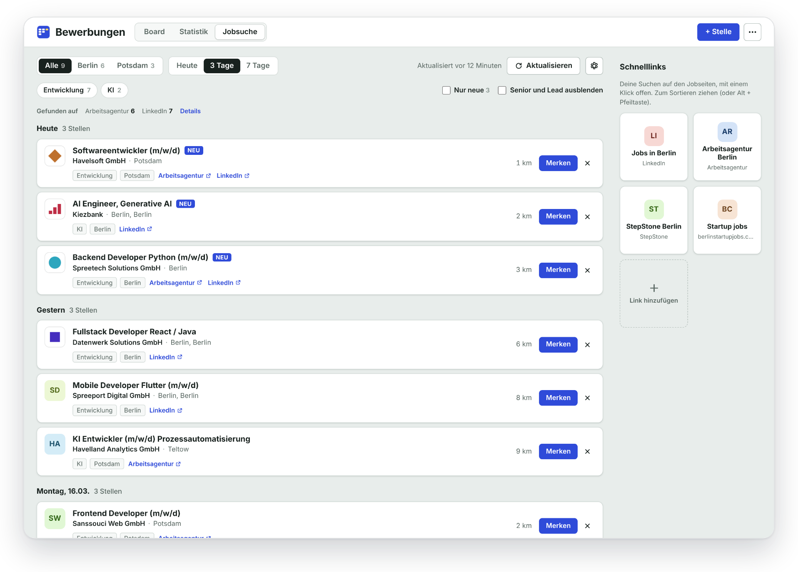
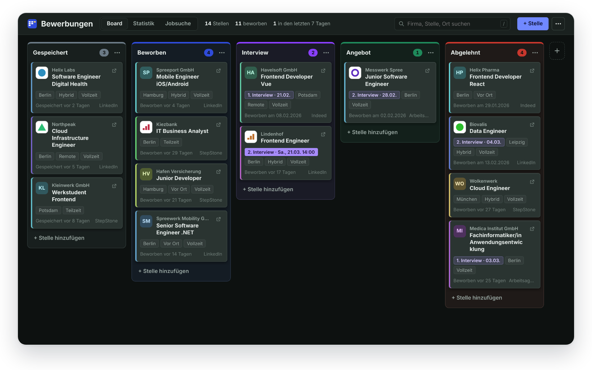

# Job Application Tracker

**Stelleninserate mit einem Klick speichern und alle Bewerbungen auf einem übersichtlichen Board verfolgen.** 
Kostenlos, Open Source, und alles bleibt in deinem Browser.

[Funktionen](#funktionen) · [Installation](#installation) · [Datenschutz](#datenschutz) · [English](README.md)

 

## Funktionen

- **Ein Klick auf jedem Inserat.** Die Seitenleiste füllt Firma, Stelle, Ort, Pensum, Arbeitsmodell, Beschreibung, Link und Logo für dich aus.
- **Ein Board für deine Bewerbungen.** Gespeichert, beworben, Interview, Angebot, Absage. Karten ziehst du einfach weiter.
- **Jede Interviewrunde.** Datum, Uhrzeit, Telefon, Video oder vor Ort, mit Notiz. Du siehst immer, wie weit eine Bewerbung gekommen ist.
- **Deine Zahlen auf einen Blick.** Wo Bewerbungen enden, Antwortquote, Bewerbungen pro Woche und pro Quelle.
- **Jeden Tag neue Stellen.** Eine Jobsuche für Deutschland und die Schweiz, die neue Inserate von LinkedIn, der Arbeitsagentur und jobs.ch sammelt, für die Orte und Suchbegriffe, die du festlegst.
- **Deine Schnelllinks.** Deine liebsten Suchen auf Jobseiten als Kacheln, einen Klick entfernt.
- **Alte Liste mitnehmen.** Import aus Excel oder CSV, Backup jederzeit exportieren.
- **Hell und dunkel**, auf Deutsch und Englisch.

Funktioniert auf LinkedIn, Indeed, StepStone, jobs.ch, jobup.ch, Workday, Greenhouse, Lever und den meisten Karriereseiten von Firmen.

## Genauer hingeschaut

<table>
<tr>
<td width="38%"></td>
<td>

### Direkt aus dem Inserat speichern

Inserat öffnen, auf das Symbol in der Symbolleiste klicken, Felder prüfen, speichern. Die Seitenleiste bleibt offen, während du weitersurfst, und was du eingetippt hast, bleibt als Entwurf erhalten.

</td>
</tr>
</table>

### Wissen, wo du stehst

Jede Bewerbung ist eine Karte. Schieb sie von Spalte zu Spalte, trag Interviewrunden ein, behalte Notizen und die ganze Stellenbeschreibung an einem Ort.

### Deine Zahlen

Verfolge jede Bewerbung vom ersten Klick bis zur letzten Antwort und sieh, welche Jobseiten dir wirklich Antworten bringen.

### Neue Stellen finden

Beim ersten Öffnen der Jobsuche legst du deine Orte und Suchbegriffe fest. Nichts ist vorgegeben. Neue Inserate der letzten Tage landen in einer Liste, dieselbe Stelle auf zwei Seiten wird zu einer Zeile, und mit Merken liegt sie direkt auf deinem Board. Rechts stehen deine Schnelllinks.

### Hell und dunkel

## Installation

Die Erweiterung ist noch nicht im Chrome Web Store. Die Installation dauert eine Minute:

1. Dieses Repository herunterladen (grüner Button **Code**, **Download ZIP**) und entpacken.
2. `chrome://extensions` öffnen und oben rechts den **Entwicklermodus** einschalten.
3. **Entpackte Erweiterung laden** klicken und den Ordner `extension` wählen.
4. Die Erweiterung über das Puzzle-Symbol in der Symbolleiste anheften.

Läuft in Chrome, Edge, Brave und anderen Chromium-Browsern. Die Oberfläche ist auf Deutsch, wenn dein Browser auf Deutsch eingestellt ist.

**Update:** im Board-Menü ein Backup exportieren, die Dateien im gleichen Ordner `extension` ersetzen und bei `chrome://extensions` auf den Neu-laden-Pfeil klicken. Deine Bewerbungen bleiben erhalten.

## Datenschutz

- Kein Konto, keine Cloud, kein Tracking. Deine Bewerbungen liegen nur in deinem Browser.
- Die Erweiterung spricht nur mit den Jobseiten, auf denen du sie benutzt, und mit den Jobportalen, die du durchsuchst.
- Alles als Backup oder CSV exportieren oder mit einem Klick löschen.

Details in [PRIVACY.md](PRIVACY.md) (englisch).

## Mehr

- [Anleitung](docs/GUIDE.md): alle Funktionen Schritt für Schritt (englisch)
- [Technische Hinweise](docs/DEVELOPMENT.md): reines JavaScript, Manifest V3, ohne Build-Schritt und ohne Framework; wie es funktioniert, Berechtigungen, Tests (englisch)
- [Änderungen](CHANGELOG.md)

Ideen und Fehlermeldungen gerne als [Issue](../../issues). Wenn eine Jobseite nicht mehr funktioniert, hilft ein Link zu einem Beispielinserat sehr.

## Lizenz

[MIT](LICENSE)
