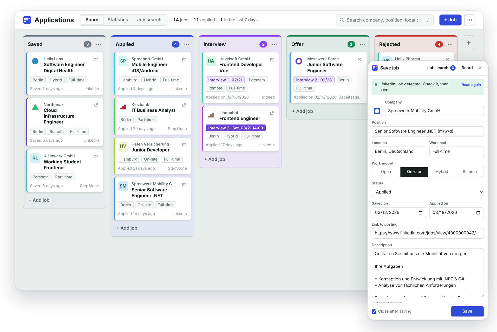
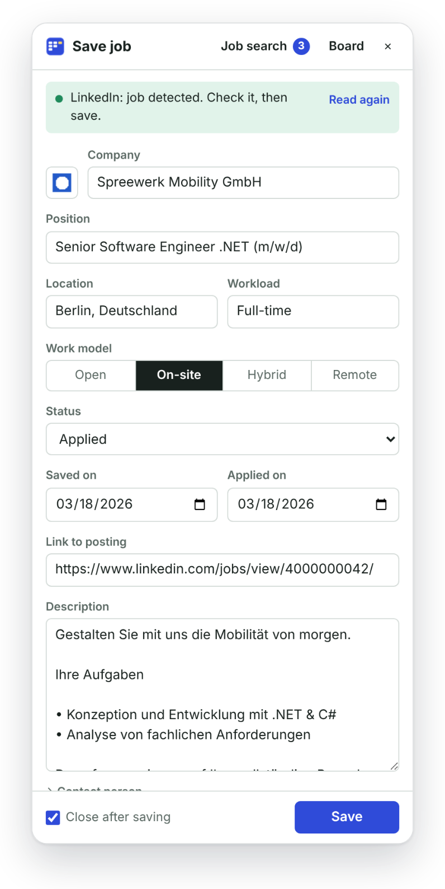
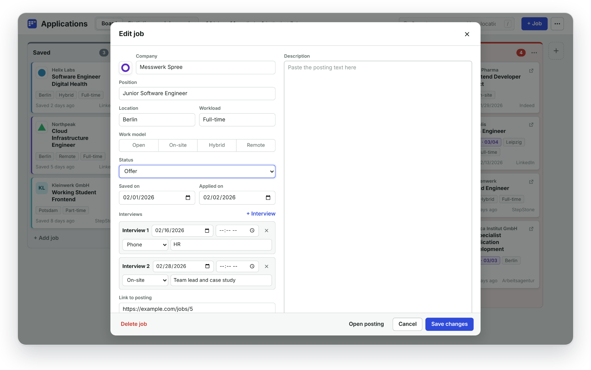
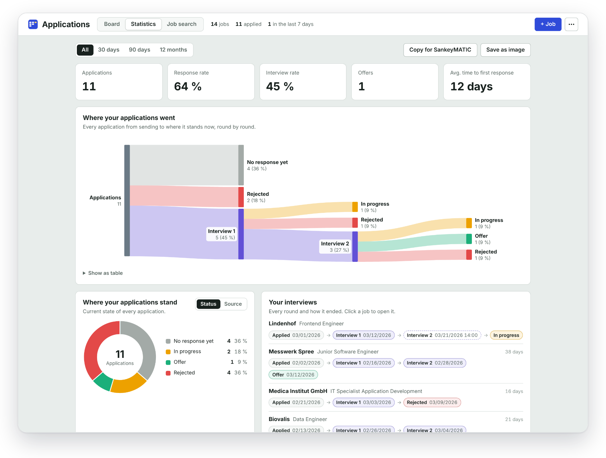
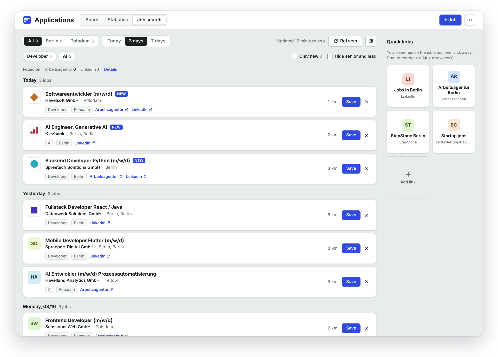
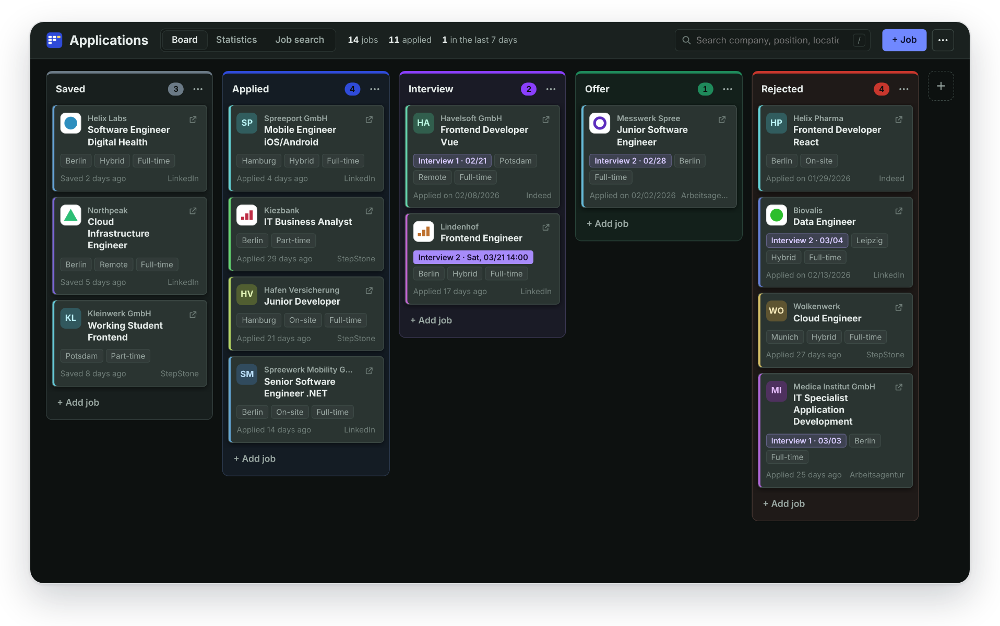

# Job Application Tracker

**Save job ads in one click and keep every application on one clear board.** 
Free, open source, and everything stays in your browser.

[Features](#features) · [Install](#install) · [Privacy](#privacy) · [Deutsch](README.de.md)

 

## Features

- **One click on any job ad.** The side panel fills in company, position, location, workload, work model, description, link and logo for you.
- **A board for your applications.** Saved, applied, interview, offer, rejected. Drag cards along as things move.
- **Every interview round.** Date, time, phone, video or on-site, with a note. You always see how far each application got.
- **Your numbers at a glance.** Where applications end, response rate, applications per week and per source.
- **New jobs every day.** A job search for Germany and Switzerland that collects fresh postings from LinkedIn, the Arbeitsagentur and jobs.ch, for the places and search terms you choose.
- **Your own quick links.** Your favourite searches on job sites as tiles, one click away.
- **Bring your old list.** Import from Excel or CSV, export a backup any time.
- **Light and dark mode**, in English and German.

Works on LinkedIn, Indeed, StepStone, jobs.ch, jobup.ch, Workday, Greenhouse, Lever and most company career pages.

## A closer look

<table>
<tr>
<td width="38%"></td>
<td>

### Save from the job ad

Open a job ad, click the icon in your toolbar, check the fields, save. The panel stays open while you browse, and whatever you typed is kept as a draft until you save it.

</td>
</tr>
</table>

### Know where you stand

Each application is a card. Move it from column to column, add interview rounds, keep notes and the full job description in one place.

### See your numbers

Follow every application from the first click to the last answer, and see which job sites actually bring replies.

### Find new jobs

The first time you open the job search, you pick your places and search terms. Nothing is preset. New postings from the last days show up in one list, the same job on two sites becomes one row, and saving it puts it straight on your board. Your quick links sit on the right.

### Light and dark

## Install

The extension is not in the Chrome Web Store yet. Installing it takes a minute:

1. Download this repository (green **Code** button, **Download ZIP**) and unzip it.
2. Open `chrome://extensions` and switch on **Developer mode** (top right).
3. Click **Load unpacked** and choose the `extension` folder.
4. Pin the extension with the puzzle icon in the toolbar.

Works in Chrome, Edge, Brave and other Chromium browsers.

**Updating:** export a backup from the board menu, replace the files in the same `extension` folder and click the reload arrow on `chrome://extensions`. Your applications stay.

## Privacy

- No account, no cloud, no tracking. Your applications are stored in your browser only.
- The extension only talks to the job sites you use it on and the job portals you search.
- Export everything as a backup or CSV, or delete it all with one click.

Details in [PRIVACY.md](PRIVACY.md).

## More

- [User guide](docs/GUIDE.md): every feature step by step
- [Technical notes](docs/DEVELOPMENT.md): plain JavaScript, Manifest V3, no build step and no framework; how it works, permissions, tests
- [Changelog](CHANGELOG.md)

Ideas and bug reports are welcome as [issues](../../issues). If a job site stopped working, a link to an example ad helps a lot.

## License

[MIT](LICENSE)
