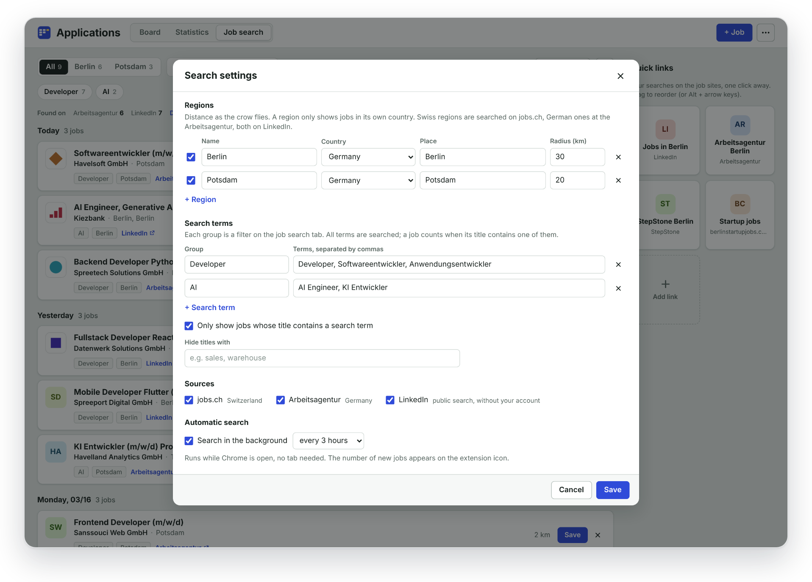

# User guide

[Back to the README](../README.md)

- [Save a job](#save-a-job)
- [The board](#the-board)
- [Interview rounds](#interview-rounds)
- [Statistics](#statistics)
- [Job search](#job-search)
- [Quick links](#quick-links)
- [Import an existing list](#import-an-existing-list)
- [Backup, update, delete](#backup-update-delete)
- [Keyboard](#keyboard)

## Save a job

1. Open a job ad and click the extension icon in the toolbar (or press `Alt+Shift+J`).
2. The side panel fills in company, position, location, workload, work model (on-site, hybrid, remote), the description, the link, the company logo and, when the ad names one, a contact person.
3. Check the fields, add notes, click **Save**. A new job starts as **Applied** with today's date; pick another status if you only want to keep it for later.

The panel stays open while you work. Copy text from the page, switch tabs, come back: what you typed is kept as a draft for that ad. It closes when you click the X, or after saving if "Close after saving" is on. Opening an ad you already saved edits that card instead of adding a second one.

If a page cannot be read, fill in the fields yourself, or select the ad text on the page and click **Insert selected text**.

Logos come from the ad or from the company's career site. In the job dialog you can click the logo to choose another image, drop one on it or paste a screenshot.

## The board

**Board** in the side panel opens the board in its own tab. Drag cards between columns, rename, recolor, add and reorder columns, search with `/`. When a card leaves the first column without an application date, today's date is set; you can change it any time. A deleted card can be brought back with **Undo**.

## Interview rounds

Open a card and click **+ Interview** for each round: date, time, type (phone, video, on-site) and a note. The card shows the latest round, planned ones stand out, and a rejected card still shows how far it got. Adding a round moves the card to the interview column; dragging a card there adds round 1.

## Statistics

The **Statistics** tab follows every application round by round: no reply, rejected without interview, after interview 1, after interview 2, offer, still running. Next to it a chart of where everything stands (or by source), a list of all interviews, response and interview rate, time to the first answer, applications per week and per source. The flow chart can be saved as an image.

## Job search

Open the board and click **Job search**. The first time, the settings open: nothing is preset, so add at least one region and one search term and save. The first search then starts and takes about half a minute. After that it runs every few hours in the background while Chrome is open, and the toolbar icon shows how many new postings came in.

The list shows postings of today, the last 3 or the last 7 days. Filter by region, search term, "only new", and hide senior roles. The same job on two sites is one row with both links. **Save** puts it on the board with description and logo, the X hides it (with undo). Jobs already on your board are left out.

The gear button opens the settings:

- **Regions**: a name, the country (Germany or Switzerland), a place and a radius in km. German regions are searched at the Arbeitsagentur, Swiss ones on jobs.ch, both on LinkedIn. A region only shows jobs in its own country. Add as many places as you like.
- **Search terms**: groups of terms separated by commas, for example a group "Developer" with "Developer, Softwareentwickler". Each group becomes a filter chip. With "Only show jobs whose title contains a search term" switched on, everything else is left out.
- **Hide titles with**: words like "Werkstudent" (also hides "Werkstudentin").
- **Sources** and **automatic search** (every 1, 3, 6 or 12 hours).

**Details** next to the list of sources shows what each site sent and why postings were left out (too old, too far away, other country).

## Quick links

The tiles on the right of the job search open your own searches on job sites in a new tab. There are none at the start; add the ones you use.

- **+ Add link**: search on the site as usual, set your filters, then copy the address from the address bar and paste it in. You can also drag a link from another tab onto the tiles.
- The pencil on a tile changes its name, link and image: the site's own icon, an image of your own (choose, drop or paste one) or none.
- Drag tiles to sort them, or use Alt + arrow keys. Deleting can be undone.

## Import an existing list

Board menu (**...**), **Import from Excel or CSV**. Columns are matched by their headings (English, German, French), you check which column means what and which status goes where, duplicates are skipped, and one click undoes the import. The file is read in your browser and never uploaded. Old .xls files: save them as .xlsx first.

## Backup, update, delete

- **Export backup** in the board menu saves everything (jobs, columns, quick links) as a JSON file. **Import backup** adds what is missing and never removes anything.
- **Update**: export a backup, replace the files in the same `extension` folder, click the reload arrow on `chrome://extensions`. Chrome keeps the data as long as the extension is loaded from the same folder.
- **Delete all data** in the board menu removes everything. Uninstalling the extension does too, so export a backup first.

## Keyboard

| Key | Action |
| --- | --- |
| `Alt+Shift+J` | Open the side panel |
| `Ctrl+Enter` / `Cmd+Enter` | Save (panel and dialog) |
| `/` | Search the board |
| `Enter` on a card | Open it |
| `Alt+Left` / `Alt+Right` | Move a card to the previous or next column |
| `Alt+Up` / `Alt+Down` | Move a card within its column |
| `Alt` + arrow keys on a quick link | Move the tile |
